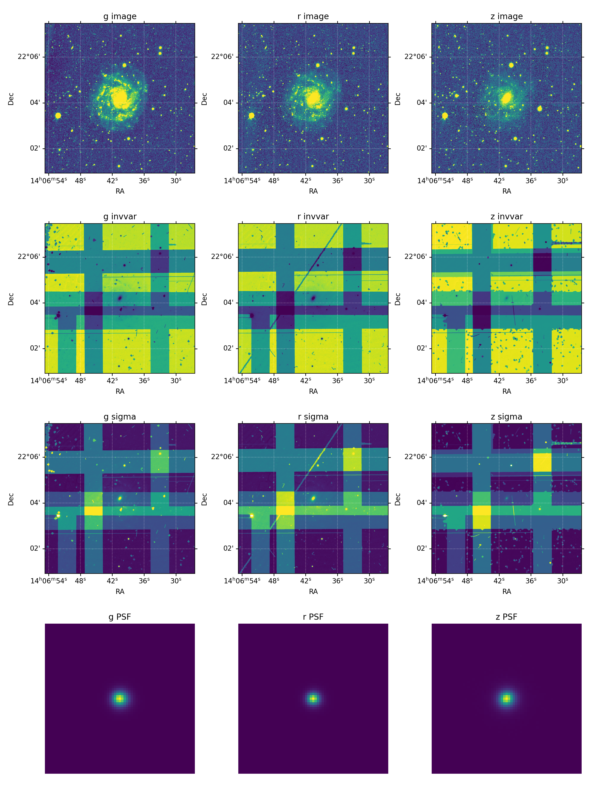
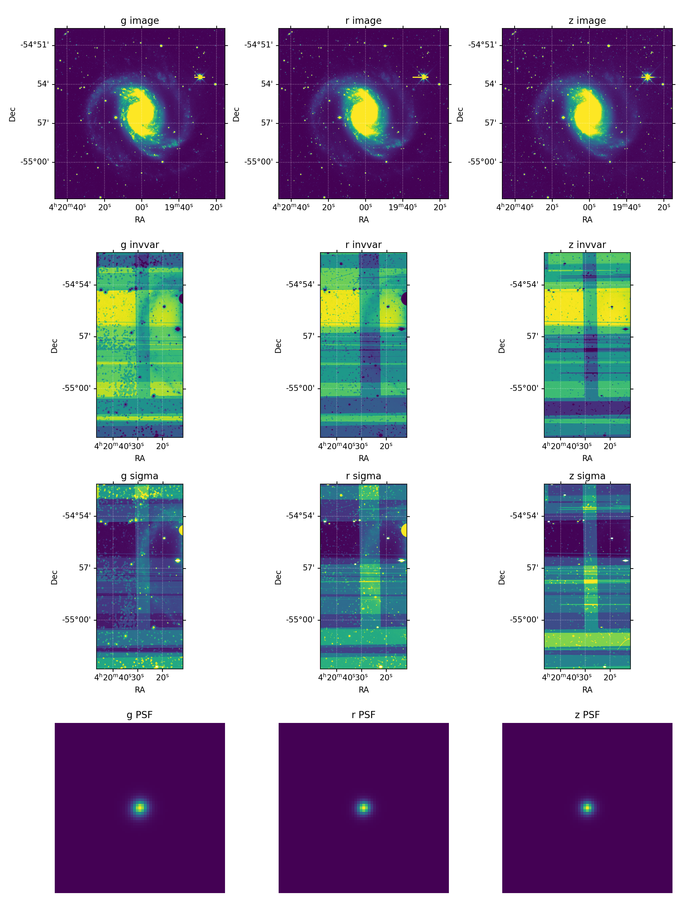
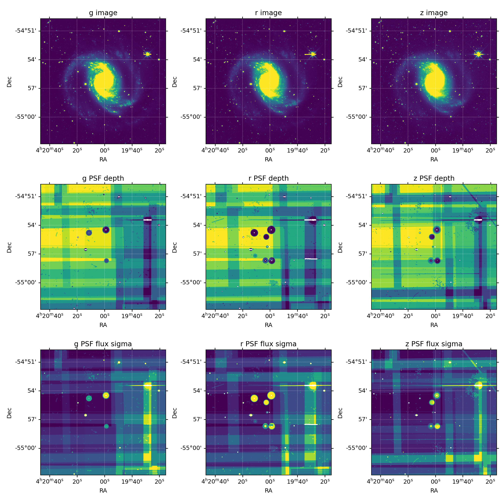

# DECaLS Downloads

Download and split Legacy Surveys g/r/z science images, aligned inverse-variance cutouts and PSFs.

Data acquisition and diagnostic visualisation only.

[Installation](#installation) · [Image download](#example-ugc9024) · [Brick depth](#optional-dr9-brick-depth--ngc1566)

## Installation

```bash
pip install --upgrade git+https://github.com/akhilkrishnar0/decals-downloads.git
```

## Example: UGC9024

```python
from decals_pipeline_class import DecalsPipeline

galaxies_new = ["UGC9024"]
GALAXY_CENTERS = {"UGC9024": (211.669,  22.070)}  # RA, Dec in degrees

pipe = DecalsPipeline(layer="ls-dr9", galaxy_centers=GALAXY_CENTERS)
pipe.run(
    galaxies_new, size=1500, skip_download=True,
    do_plot=False, do_psf_split=False,
    force_download=False, do_save_split=True
)
```

Coordinates are supplied by the user. If omitted, SIMBAD is queried; on failure, enter RA and Dec manually in degrees.

Set `do_plot=True` for the 12-panel diagnostic. Outputs are saved in `decals_data/`.

The `&invvar` cutout contains a science cube and an inverse-variance cube, identified by `IMAGETYP`. The pipeline selects g/r/z using `BAND0`, `BAND1`, etc., or `BANDS`, and checks image shape and WCS before splitting. Requests explicitly specify `bands=grz` and `pixscale=0.262` (including DR11, which may also provide i). For old cached `&subimage` files or a changed release, use `force_download=True` once; then reuse the new downloads.

## Example output — UGC9024



## Inverse-variance maps and the brick-depth alternative

When using the `&subimage` option, inverse-variance maps are retrieved from individual survey bricks and may show block-like structures. The NGC1566 diagnostic below illustrates the earlier subimage-based output. Instead, use the `&invvar` option with `pixscale=0.262` to obtain inverse-variance cutouts on the same spatial grid as the science images. This is the default in the current package.

Alternatively, the package provides an optional DR9 brick-depth workflow to download depth maps and generate corresponding diagnostic plots. The Legacy Surveys divide the sky into bricks of approximately 0.25° × 0.25°, with coadded images, inverse-variance maps, PSF information and depth products. The depth map represents the spatially varying inverse variance of PSF-fitted point-source flux, reflecting observational coverage, background noise and image quality. The relevant depth maps are sampled onto the science image WCS in g, r and z. The corresponding point-source flux uncertainty is $\sigma_{\rm PSF}=1/\sqrt{\mathrm{depth}}$, in nanomaggies. Depth maps are not equivalent to pixel-level inverse-variance maps; additional assumptions are required for extended-source or aperture photometry.

**References**

- [Legacy Surveys DR9 — Data Release Description](https://www.legacysurvey.org/dr9/description/)
- [Legacy Surveys DR9 — Data Products and Depth Map Definitions](https://www.legacysurvey.org/dr9/files/)
- [DR9 Brick Data Repository — NERSC](https://portal.nersc.gov/cfs/cosmo/data/legacysurvey/dr9/)
- [Discussion on Bricks, Inverse-Variance Maps and Cutout Shapes](https://discuss.legacysurvey.org/t/question-about-bricks-inverse-variance-maps-and-cutout-shapes/10502)

The last reference also discusses the `&invvar` cutout option at the native pixel scale of 0.262 arcsec/pixel, which is now the default for obtaining matching pixel-level inverse-variance maps. The optional DR9 depth workflow remains separate.

## Example output — NGC1566 (earlier subimage-based diagnostic)



## Optional: DR9 brick depth — NGC1566

To obtain complementary point-source sensitivity maps, download DR9
PSF-depth bricks and sample them on the science image grid:

```python
from decals_pipeline_class import DecalsPipeline

pipe = DecalsPipeline(
    layer="ls-dr9",
    galaxy_centers={"NGC1566": (65.0042, -54.9378)}
)
pipe.run(["NGC1566"], size=3000, skip_download=True,
         do_plot=True, do_psf_split=False,
         do_save_split=True, do_depth=True, depth_region="south")
```

For previously downloaded science images only:

```python
pipe.depth_maps("NGC1566", region="south")
```

- `outputs/depth/NGC1566/`: g/r/z depth and PSF flux sigma FITS on the science WCS and shape; brick coverage CSV.
- `plots/NGC1566_depth.png`: science, depth and PSF flux sigma (3 × 3).
- `brick_maps/`: cached original DR9 FITS.

All bricks intersecting the science pixel centres are considered. Each centre
uses its unique survey brick, sampled by nearest neighbour. Missing or
nonpositive values remain NaN. Choose the matching DR9 north/south region
explicitly; NGC1566 uses south.

**Depth is PSF-fitted point-source flux inverse variance**, not science-pixel
inverse variance. Sigma = 1/sqrt(depth), in nanomaggies. No aperture-noise
conversion or variance resampling is performed. Original inverse-variance
files are unchanged.
### Example depth output — NGC1566



## Repository structure

```text
src/        Python modules
examples/   Runnable download and brick-depth examples
figures/    Example diagnostic plots
```
